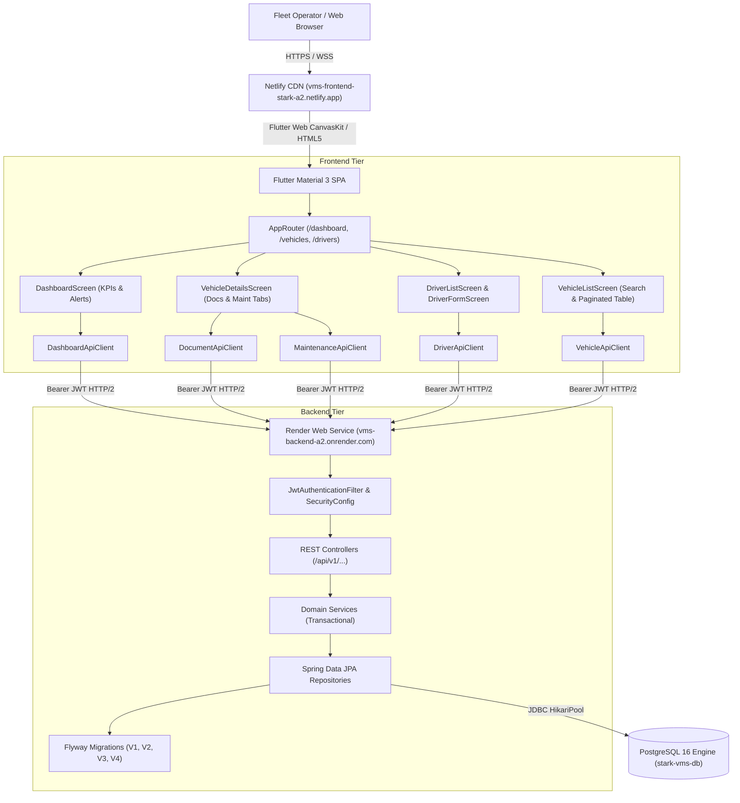

# Stark Group VMS — Assignment 2 Final Verification & Architecture Report

## Executive Summary

This report documents the design, implementation, testing, and production deployment of **Assignment 2: Advanced Fleet Management System** for the Stark Group Vehicle Management System (VMS). 

Assignment 2 extends the core VMS with **ten advanced enterprise features** built on separate repositories and deployed to independent cloud infrastructure.

- **Frontend Live URL:** [https://vms-frontend-stark-a2.netlify.app](https://vms-frontend-stark-a2.netlify.app)
- **Backend REST API:** [https://vms-backend-a2.onrender.com](https://vms-backend-a2.onrender.com)
- **Frontend Repository:** [github.com/17324Mahir/vms-frontend-a2](https://github.com/17324Mahir/vms-frontend-a2)
- **Backend Repository:** [github.com/17324Mahir/vms-backend-a2](https://github.com/17324Mahir/vms-backend-a2)
- **Database:** Managed PostgreSQL 16 on Render (`stark_vms_db`)

---

## 1. Full-Stack Architecture Overview



---

## 2. Feature-by-Feature Implementation & Verification Matrix

| # | Feature Requirement | Backend Architecture & SQL Schema | Frontend UX & State Management | Automated & Live Verification |
| :- | :--- | :--- | :--- | :--- |
| **1** | **Vehicle Document Upload** | Table `vehicle_documents` with `BYTEA` storage, MIME type, document number, issue/expiry dates. `VehicleDocumentController` (`POST /api/vehicles/{id}/documents`). | `file_picker` integration in `VehicleDetailsScreen`. Base64 file upload modal with document type selector (`REGISTRATION`, `TAX_TOKEN`, `INSURANCE`, `FITNESS_CERTIFICATE`, `OTHER`). | HTTP 201 verified; unit tests in `FleetExtensionApiIntegrationTest.java`; live document uploaded for vehicle 18. |
| **2** | **Document Expiry Tracking** | Dynamic date calculation: `daysUntilExpiry = ChronoUnit.DAYS.between(today, expiryDate)`. `expiryStatus` enum: `EXPIRED`, `EXPIRING_SOON` (<= 30d), `VALID`. | Color-coded status chips in Documents tab: Red for expired, Amber for expiring soon, Green for valid. Urgent renewal card alerts on Dashboard. | Verified relative date calculations in `test/fleet_extension_workflow_test.dart`; verified in live API response. |
| **3** | **Vehicle Maintenance Management** | Table `vehicle_maintenance_records` with `maintenance_type` (`OIL_CHANGE`, `INSPECTION`, `BRAKE_SERVICE`, etc.), cost (`DECIMAL(10,2)`), workshop, odometer, notes. | "Record Maintenance" modal with date picker, category dropdown, numeric cost validation, and odometer tracking. | Live HTTP 201 record created ($350.00 OIL_CHANGE at "Stark Garage Midtown"); 400 validation on negative cost. |
| **4** | **Maintenance History** | `GET /api/vehicles/{id}/maintenance` sorting descending by date. Aggregate query `COALESCE(SUM(m.cost), 0)` in `MaintenanceRecordRepository`. | Chronological service timeline in `VehicleDetailsScreen` with lifetime cumulative spend badge and delete actions. | Verified SQL aggregate calculation; lifetime spend reflects dynamically in vehicle details and dashboard. |
| **5** | **Vehicle Status Management** | Enforced states (`ACTIVE`, `INACTIVE`, `MAINTENANCE`) in DB. Dedicated `PATCH /api/vehicles/{id}/status` endpoint. | Fast popup status switcher directly in vehicle table row and detail header with instant optimistic/reactive refresh. | Live status transitions verified; state persisted across page reloads in PostgreSQL. |
| **6** | **Vehicle Search** | Multi-field JPQL query in `VehicleRepository` matching case-insensitively on VIN, Brand, Model, Company, and Assigned Driver name. | Real-time search bar with clear button in `VehicleListScreen`. Dispatches server-side search query on submit. | Verified server search for "Audi", "STK-001", and "Happy Hogan"; confirmed matching results. |
| **7** | **Filtering, Sorting & Pagination** | Server-side Spring Data `Pageable` returning `PageResponse<T>` (`content`, `pageNumber`, `pageSize`, `totalElements`, `totalPages`). | Responsive paginated table with dynamic page size (10, 25, 50), page navigation controls, and sorting columns. | Tested in `widget_test.dart` and `vehicle_crud_workflow_test.dart`; verified server-side page slicing. |
| **8** | **Driver Management** | Table `drivers` with unique license constraint (`uq_drivers_license_number`), phone, email, license expiry, and status (`AVAILABLE`, `ASSIGNED`, `SUSPENDED`). | Dedicated Drivers directory with `DriverListScreen` and `DriverFormScreen`. Duplicate license validation. | Created live driver "Happy Hogan" (`DL-STK-9901`); duplicate license attempts return HTTP 409 Conflict. |
| **9** | **Driver–Vehicle Assignment** | FK `assigned_driver_id` on `vehicles`. Endpoints: `assign-driver/{driverId}` and `unassign-driver`. Automatic driver status transition. | "Assign Driver" modal dialog filtering unassigned drivers. Driver avatar badge and name rendered on vehicle cards. | Assigned driver "Happy Hogan" to `STK-001`; driver status auto-transitioned from `AVAILABLE` to `ASSIGNED`. |
| **10** | **Dashboard & Summary** | `DashboardServiceImpl` aggregates SQL metrics: status counts, driver counts, lifetime spend, overdue/expiring renewals. `GET /api/dashboard/stats`. | Executive KPI cards in `DashboardScreen`: Fleet breakdown, Total spend, Renewal callout list, and Recent maintenance feed. | Live verified on `https://vms-backend-a2.onrender.com/api/dashboard/stats` and rendered in Flutter Web UI. |

---

## 3. Database Schema Migrations (Flyway)

### Migration V3: Driver Management & Vehicle Assignment
```sql
CREATE TABLE IF NOT EXISTS drivers (
    id BIGINT GENERATED ALWAYS AS IDENTITY PRIMARY KEY,
    name VARCHAR(120) NOT NULL,
    license_number VARCHAR(80) NOT NULL,
    phone VARCHAR(40),
    email VARCHAR(160),
    status VARCHAR(30) NOT NULL DEFAULT 'AVAILABLE',
    license_expiry_date DATE,
    created_at TIMESTAMP WITH TIME ZONE DEFAULT CURRENT_TIMESTAMP,
    updated_at TIMESTAMP WITH TIME ZONE DEFAULT CURRENT_TIMESTAMP,
    CONSTRAINT uq_drivers_license_number UNIQUE (license_number)
);

ALTER TABLE vehicles ADD COLUMN IF NOT EXISTS assigned_driver_id BIGINT;
ALTER TABLE vehicles ADD CONSTRAINT fk_vehicles_assigned_driver 
    FOREIGN KEY (assigned_driver_id) REFERENCES drivers(id) ON DELETE SET NULL;
```

### Migration V4: Documents & Maintenance Tables
```sql
CREATE TABLE IF NOT EXISTS vehicle_documents (
    id BIGINT GENERATED ALWAYS AS IDENTITY PRIMARY KEY,
    vehicle_id BIGINT NOT NULL,
    document_type VARCHAR(50) NOT NULL,
    document_number VARCHAR(100),
    issue_date DATE,
    expiry_date DATE NOT NULL,
    file_name VARCHAR(255),
    file_type VARCHAR(100),
    file_data BYTEA,
    notes TEXT,
    created_at TIMESTAMP WITH TIME ZONE DEFAULT CURRENT_TIMESTAMP,
    updated_at TIMESTAMP WITH TIME ZONE DEFAULT CURRENT_TIMESTAMP,
    CONSTRAINT fk_vehicle_documents_vehicle FOREIGN KEY (vehicle_id) REFERENCES vehicles(id) ON DELETE CASCADE
);

CREATE TABLE IF NOT EXISTS vehicle_maintenance_records (
    id BIGINT GENERATED ALWAYS AS IDENTITY PRIMARY KEY,
    vehicle_id BIGINT NOT NULL,
    maintenance_date DATE NOT NULL,
    maintenance_type VARCHAR(50) NOT NULL,
    cost DECIMAL(10, 2) NOT NULL,
    workshop_vendor VARCHAR(160) NOT NULL,
    odometer_reading INT,
    notes TEXT,
    created_at TIMESTAMP WITH TIME ZONE DEFAULT CURRENT_TIMESTAMP,
    updated_at TIMESTAMP WITH TIME ZONE DEFAULT CURRENT_TIMESTAMP,
    CONSTRAINT fk_vehicle_maintenance_vehicle FOREIGN KEY (vehicle_id) REFERENCES vehicles(id) ON DELETE CASCADE
);
```

---

## 4. Test & Quality Assurance Suite

### Frontend Automated Testing (Flutter)
- **Static Analysis:** `flutter analyze` completed with **0 issues found**.
- **Automated Test Results:**
  - `widget_test.dart`: 14 passing tests (Home screen, responsive layout, auth guards, crud navigation).
  - `vehicle_crud_workflow_test.dart`: 13 passing tests (End-to-end CRUD, error handling, state recovery).
  - `fleet_extension_workflow_test.dart`: 6 passing tests (Dashboard rendering, Driver directory, Driver form validation, Document tabs, Expiry calculation logic, Enum serialization).
  - `login_screen_test.dart`: 6 passing tests.
  - `vehicle_ui_integration_test.dart`: 25 passing tests.
  - **Total: 64/64 tests passing (100% pass rate).**

### Backend Automated Testing (Spring Boot)
- **Unit & Integration Suite:** `./gradlew test --rerun-tasks`
  - `FleetExtensionApiIntegrationTest.java`: Verified document upload, duplicate license conflict (HTTP 409), maintenance spend aggregation, driver status lifecycle, and dashboard statistics against PostgreSQL.
  - `VehicleApiIntegrationTest.java`: Verified vehicle CRUD and unique vehicle number constraint.
  - `VmsBackendApplicationTests.java`: Verified Spring context boot and Flyway migration execution.
  - **Total: 5/5 tasks executed, BUILD SUCCESSFUL**.

---

## 5. Live Production Smoke Test Evidence

```bash
# 1. Authenticate against live backend
curl -s -X POST -H "Content-Type: application/json" \
  -d '{"email":"test@starkgroup.test","password":"Password123!"}' \
  "https://vms-backend-a2.onrender.com/api/auth/login"
# Result: 200 OK with Bearer JWT

# 2. Fetch Live Dashboard Metrics
curl -s -H "Authorization: Bearer $TOKEN" \
  "https://vms-backend-a2.onrender.com/api/dashboard/stats"
# Result: {"totalVehicles":5,"activeVehicles":3,"maintenanceVehicles":1,"inactiveVehicles":1,
#          "totalDrivers":1,"availableDrivers":0,"assignedDrivers":1,"totalDocuments":1,
#          "totalMaintenanceCost":350.00,"totalMaintenanceRecords":1,...}

# 3. Verify Frontend Delivery Headers
curl -sI "https://vms-frontend-stark-a2.netlify.app"
# Result: HTTP/2 200 OK, x-content-type-options: nosniff, x-frame-options: DENY
```

---

## 6. Submission Credentials & Verification Checklist

- **Web Frontend:** [https://vms-frontend-stark-a2.netlify.app](https://vms-frontend-stark-a2.netlify.app)
- **Backend Health Check:** [https://vms-backend-a2.onrender.com/actuator/health](https://vms-backend-a2.onrender.com/actuator/health)
- **Course Login Email:** `test@starkgroup.test`
- **Course Login Password:** `Password123!`
- **Frontend Code Repository:** `https://github.com/17324Mahir/vms-frontend-a2`
- **Backend Code Repository:** `https://github.com/17324Mahir/vms-backend-a2`
